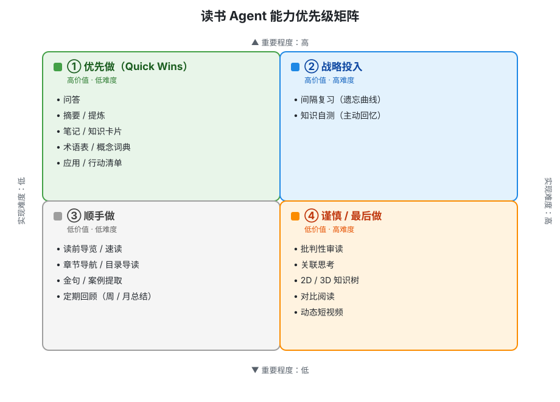

# 读书 Agent 功能架构

> 状态：构想分析稿（仅架构与思路，不含实现代码）
> 目标：输入一本书，把它变成「可问答、可提炼、可沉淀、可关联、可记忆、可可视化」的个人知识。

---

## 1. 一句话定位

读书 agent = **把一本书从「一次性阅读」变成「可反复调用的知识资产」**。

完整的能力不是「问答 + 几个输出」，而是一条从「读」到「懂」到「用」到「记住」的认知闭环：

> 读（输入）→ 懂（理解）→ 整理（结构化）→ 用（行动）→ 记住（内化）。

---

## 2. 核心结论：能力是分层系统，不是平铺清单

所有能力**难度天差地别、且有严格的依赖关系**。真正可落地的形态是五层结构（横向）+ 一条横切底座：

```
┌──────────────────────────────────────────────────────────────┐
│  L4 多模态层   观点 → 脚本 → 图文/画面 → 配音 → 动态短视频        │
├──────────────────────────────────────────────────────────────┤
│  L3 呈现层     2D 知识树/图谱 · 3D 知识树 · 知识卡片渲染           │
├──────────────────────────────────────────────────────────────┤
│  L2 知识层     概念抽取 · 关系抽取 · 构建知识图谱（节点+边）        │
├──────────────────────────────────────────────────────────────┤
│  L1 理解层     问答 · 摘要/提炼 · 笔记/卡片 · 术语表 · 应用清单    │
│               （RAG 底座：切块 / 索引 / 检索）                   │
├──────────────────────────────────────────────────────────────┤
│  L0 输入层     多格式解析（txt / epub / pdf / 扫描 OCR）         │
└──────────────────────────────────────────────────────────────┘
横切能力（贯穿所有层）：
  个人知识库（跨书积累）· 多轮记忆 · 引用溯源 · 缓存 · 质量评估
```

关键规律：**下层是上层的前提**。没有 L0 的解析就没有 L1 的理解；没有 L2 的「概念抽取」，L3 的知识树和「关联思考」都是空中楼阁。

---

## 3. 能力全景（17 项）

原构想 6 项 + 补充 11 项，共 17 项能力：

| # | 能力 | 重要程度 | 难度 | 所属层 |
|---|------|---------|------|--------|
| 1 | 问答 | P0 核心 | ★ | L1 理解 |
| 2 | 摘要 / 提炼 | P0 核心 | ★ | L1 理解 |
| 3 | 笔记 / 知识卡片 | P1 重要 | ★ | L1 理解 |
| 4 | 术语表 / 概念词典 | P1 重要 | ★ | L1 理解 |
| 5 | 应用 / 行动清单 | P1 重要 | ★ | L1 理解 |
| 6 | 间隔复习（遗忘曲线） | P1 重要 | ★★ | 横切 |
| 7 | 知识自测（主动回忆） | P1 重要 | ★★ | L1 理解 |
| 8 | 读前导览 / 速读 | P2 进阶 | ★ | L1 理解 |
| 9 | 章节导航 / 目录导读 | P2 进阶 | ★ | L0/L1 |
| 10 | 批判性审读 | P2 进阶 | ★★ | L1 理解 |
| 11 | 关联思考 | P2 进阶 | ★★ | L2 知识 |
| 12 | 2D 知识树 / 图谱 | P2 进阶 | ★★ | L3 呈现 |
| 13 | 金句 / 案例提取 | P3 可选 | ★ | L1 理解 |
| 14 | 对比阅读（跨书） | P3 可选 | ★★ | L2 知识 |
| 15 | 定期回顾（周/月总结） | P3 可选 | ★ | 横切 |
| 16 | 3D 知识树 | P3 锦上添花 | ★★★ | L3 呈现 |
| 17 | 动态短视频 | P3 锦上添花 | ★★★ | L4 多模态 |

---

## 4. 按「重要程度」分类

| 档位 | 含义 | 能力 |
|------|------|------|
| **P0 核心** | 不做则 agent 不成立 | 问答、摘要/提炼 |
| **P1 重要** | 强烈建议，价值高 | 笔记卡片、术语表、应用清单、间隔复习、知识自测 |
| **P2 进阶** | 有增量，可后做 | 读前导览、章节导航、批判性审读、关联思考、2D 知识树 |
| **P3 可选** | 价值有限 / 成本高 | 金句提取、对比阅读、定期回顾、3D 知识树、动态视频 |

---

## 5. 按「实现难度」分类

| 难度 | 含义 | 能力 |
|------|------|------|
| **★ 简单** | RAG + LLM 文本，阶段一二三即可做 | 问答、摘要、笔记卡片、术语表、应用清单、读前导览、章节导航、金句提取、定期回顾 |
| **★★ 中等** | 需结构化抽取 / 图谱 / 额外机制 | 间隔复习、知识自测、批判性审读、关联思考、2D 知识树、对比阅读 |
| **★★★ 困难** | 多模态 / 高成本 / 不可控 | 3D 知识树、动态视频 |

---

## 6. 难度 × 重要程度矩阵（四象限）

这是做优先级决策的核心工具。**先把左上「优先做」做扎实，再向右上「战略投入」延伸，最后才碰左下（顺手做）和右下（谨慎/最后做）。**



| | **低难度（★）** | **高难度（★★~★★★）** |
|---|---|---|
| **高重要（P0/P1）** | **① 优先做（Quick Wins）**<br>问答 · 摘要 · 笔记卡片 · 术语表 · 应用清单 | **② 战略投入**<br>间隔复习 · 知识自测 |
| **低重要（P2/P3）** | **③ 顺手做**<br>读前导览 · 章节导航 · 金句提取 · 定期回顾 | **④ 谨慎 / 最后做**<br>批判性审读 · 关联思考 · 2D/3D 知识树 · 对比阅读 · 视频 |

**一个重要的反向洞察**：价值最高的核心能力（问答、摘要、笔记）**恰恰是难度最低的**（★）；而难度最高的（3D、视频）**恰恰价值最低**（锦上添花）。这说明「先做简单又高价值的」是压倒性的正确策略，不要被 3D 和视频的炫酷带偏节奏。

---

## 7. 关键设计要点（原构想易漏的隐性前提）

### 7.1 概念 / 关系抽取（最关键的隐性能力）

「知识树」和「关联思考」不是直接生成的。前提是先抽取**核心概念（节点）+ 概念间关系（边）**构成知识图谱，再可视化。例：《高效学习法》→「费曼学习法 → 属于 → 主动学习」。

### 7.2 多格式输入 + OCR

「输入一本书」的形态未定义：txt / epub / mobi / 文字版 PDF / **扫描版 PDF（需 OCR）**；还有几十万字短文 vs 百万字专著的长短差异。

### 7.3 笔记的「落地」：存储 + 导出 + 跨书积累

笔记/卡片要**持久化 + 可导出**（Obsidian / Markdown / Notion / Anki），并**跨书积累**成个人知识库，否则读完就丢。

### 7.4 三个横切能力

- **多轮对话记忆**：连续提问记住上文，不"失忆"；
- **引用溯源**：回答/笔记可跳回原文哪章哪段（可信度关键）；
- **质量评估**：用「已知答案的问题」做回归，每次改动后验证。

---

## 8. 两个高风险点

### 8.1 视频：先走「图文 + 配音」，别做真·AI 视频

| 路线 | 做法 | 成本 | 可控性 |
|------|------|------|--------|
| **图文 + 配音**（推荐） | 观点文字 + 静态图/关键帧 + 转场 + TTS 配音 + 字幕 | 低 | 高 |
| 真·AI 视频生成 | 文本 → 视频模型（可灵/Sora/即梦类） | 高 | 低 |

### 8.2 3D 知识树：先 2D 后 3D

3D 视觉炫，但**可读性、信息密度、交互、导出都不如 2D**。核心价值在「抽取准不准」，不在「渲染成几维」。

---

## 9. 数据与知识底座（贯穿始终）

```
单本书 → 书库（多本书索引） → 个人知识库（跨书关联）
                              ├─ 笔记/卡片库
                              ├─ 概念/关系图谱库
                              └─ 阅读进度/复习状态
```

有这一层，才能实现「跨书关联」「间隔复习」「笔记长期积累」，工具才会越用越有价值。

---

## 10. 演进路线（六阶段，按「优先做 → 战略投入 → 最后做」排序）

| 阶段 | 做什么 | 覆盖能力 | 状态 |
|------|--------|----------|------|
| 一 | 关键词 RAG 问答 | 问答 | ✅ 已完成 |
| 二 | 向量检索 + 分层摘要 + 章节导航 | 问答升级、摘要、导航 | 待做 |
| 三 | 结构化笔记 + 术语表 + 应用清单 + 金句提取 + 持久化 + 多轮记忆 + 引用溯源 | 笔记、术语表、应用清单、金句 | 待做 |
| 四 | 概念/关系抽取 → 2D 知识树 + 批判性审读 + 读前导览 | 2D 树、批判审读、导览 | 待做 |
| 五 | 跨书知识库 → 关联思考 + 对比阅读 + 间隔复习 + 知识自测 + 定期回顾 | 关联、对比、复习、自测、回顾 | 待做 |
| 六 | 3D 增强 + 图文配音短视频 | 3D 树、视频 | 待做 |

规律：**先把 L0/L1（读得懂、答得对、摘要准、能落地）做扎实，再向上做结构化（L2/L3）和多模态（L4）**。不要在底层不牢时去追 3D 和视频。

---

## 11. 实现引擎分工：每项能力交给谁做

一个关键认知：**「本地实现」≠「不用大模型」**。本项目的「零依赖」指的是「不引入第三方 Python 库」，而理解型能力从头到尾都是调用外部 LLM（DeepSeek 等）完成的——`build_prompt()` 拼好提示词后，本来就发给大模型推理。

所以每项能力都要先想清楚「交给哪台引擎」，分三类：


| 引擎 | 负责的能力 | 一句话原则 |
|------|-----------|-----------|
| **外部 LLM**（大脑） | 问答、摘要、术语表、应用清单、金句、批判性审读、概念/关系抽取、知识自测出题、关联思考 | 一切「理解 + 生成」的活，能调 LLM 就别自己写规则 |
| **本地代码/工具**（手脚） | 切块、建索引、检索、存储、缓存、路径、多轮记忆状态 | 确定性工程，LLM 做不了、也不该做（会幻觉、无法可靠读写文件） |
| **专用模型/服务**（器官） | embedding（中文向量）、OCR（扫描版）、TTS 配音、视频生成 | 通用 LLM 之外的专用引擎 |

三条落地原则：

1. **能调 LLM 就别自己写规则**：概念抽取、批判审读这类，手写规则又难又脆，LLM 一条 prompt 就搞定。
2. **高频操作必须本地**：检索每次问答都要跑，若每次全量喂给 LLM 又贵又慢，所以「切块 → 索引 → 本地检索」必须自己写，只把检索命中的几段喂给 LLM 生成答案。
3. **零依赖的边界在这里**：阶段二/三引入 embedding、OCR、TTS 等专用模型，会打破「零第三方库」——这正是下一节「成本与工程考量」要拍的板。

---

## 12. 成本与工程考量

- **缓存**：索引、摘要、抽取只算一次，结果缓存复用，避免重复烧 token。
- **长书成本**：百万字书的分层摘要和全量抽取调用次数多，需控制粒度。
- **零依赖原则的取舍**：向量检索、OCR、图谱、视频大概率要引入第三方库/外部 API，需在「学习纯粹性」和「能力可用性」之间选择（见 CODE_STANDARDS 第 1 条）。

---

## 13. 待你确认的决策点

1. **给谁用**：自己的本地工具，还是多用户产品（影响要不要云端/账号/数据库）？
2. **规模**：单本书，还是个人书库（决定要不要「跨书知识库」层）？
3. **关联思考的范围**：只书内关联，还是跨书/关联外部知识？
4. **视频定位**：图文配音路线，还是坚持真·AI 视频？
5. **笔记出口**：导出到哪里（Obsidian / Markdown / Notion / Anki）？

---

## 14. 与现有架构文档的关系

- 本文档描述**功能蓝图**（做什么）；`ARCHITECTURE.md` 描述**代码分层与演进**（怎么做）；`CODE_STANDARDS.md` 是**怎么写**的约束。
- 三者配合：功能蓝图 → 拆分到架构演进 → 落地时遵循代码规范。
